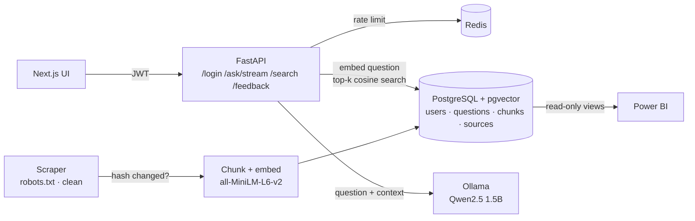

# 🧠 Knowledge Assistant

**A full-stack retrieval-augmented generation (RAG) system: permitted-site scraper → change detection → vector search → local LLM → streamed, cited answers → usage and quality analytics.**

Users sign in and ask questions in a chat UI. The backend retrieves the most relevant chunks of scraped website content from PostgreSQL (pgvector), sends them with the question to a locally hosted pretrained LLM, and streams the answer back with its sources. Pages are re-embedded only when their content changes, questions that the sources cannot answer are refused, and every request is logged for evaluation and a Power BI dashboard.

---

## Demo

**Chat UI**

   
  <b>Figure 1.</b> Chat UI (Next.js)

- **Question box:** a plain-English question, sent with Enter or Send
- **Answer:** streamed word by word as the model generates it
- **Sources:** the pages the answer was drawn from
- **👍 / 👎:** feedback saved against that answer

**Analytics dashboard**

   
  <b>Figure 2.</b> Power BI dashboard (latency, usage, feedback, faithfulness)

---

## Architecture

---

## Tech stack

| Area | Technologies |
|---|---|
| Frontend | Next.js, React, TypeScript, Tailwind CSS |
| Backend | Python, FastAPI, Pydantic, SQLAlchemy |
| Auth | JWT, Argon2 password hashing |
| Database and search | PostgreSQL, pgvector, SQL (constraints, arrays, views) |
| AI | Ollama (Qwen2.5 1.5B), sentence-transformers (all-MiniLM-L6-v2) |
| Ingestion | Requests, BeautifulSoup, SHA-256 change detection |
| Cache and limits | Redis |
| Analytics | Power BI |
| DevOps | Docker, Docker Compose, Minikube / Kubernetes |
| Testing | pytest, unittest.mock |
| Learning module | NumPy, PyTorch |

---

## Concepts applied

**Retrieval-augmented generation**
- Fixed-size chunking with overlap (500 / 100 characters)
- Pretrained sentence embeddings (384 dimensions) and cosine similarity search
- Similarity threshold that refuses off-topic questions without calling the LLM
- Prompt that treats retrieved text as information, never as instructions

**Data ingestion**
- robots.txt checks, timeouts, delays and an allowlist of sources
- Change detection on cleaned text, so unchanged pages are skipped
- Re-ingestion replaces a source's old chunks in one transaction

**Backend**
- Typed request validation and clear status codes (401, 409, 422, 429, 503)
- Streaming responses with time-to-first-token logging
- Per-user rate limiting (5 questions per 60 seconds) with a fixed-window Redis counter
- Ownership-checked feedback endpoint

**Security**
- Passwords hashed with a salted one-way algorithm
- Identity taken from the signed token, never the request body
- Secrets kept in environment variables, not in the repository
- Power BI connects as a read-only user through views that expose no questions, answers or emails

**Evaluation and analytics**
- Retrieval evaluation set with hit rate and correct-refusal counts
- Threshold sweep to choose the similarity cut-off from data
- Manual faithfulness spot-check of generated answers (7 of 8 faithful)
- Latency, usage, feedback and quality charts in Power BI

**DevOps**
- Separate Docker images for backend and frontend (multi-stage frontend build)
- Docker Compose running the database, cache, backend and frontend together
- Kubernetes manifests with Secrets, a ConfigMap, a persistent volume and health probes

**LLM fundamentals (separate learning module)**
- Character tokenizer, bigram model, training loop, single-head attention and a two-block transformer written in PyTorch
- Train versus validation loss used to show overfitting

---

## Data

Content is scraped only from sites that permit it, currently [quotes.toscrape.com](https://quotes.toscrape.com), a site built for scraping practice.
